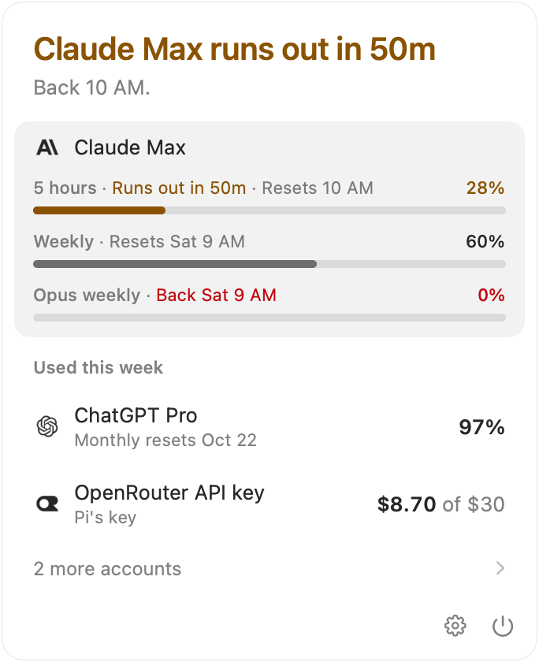

# Turnscope

[](https://github.com/joeychilson/turnscope/releases/latest)
[](https://github.com/joeychilson/turnscope/actions/workflows/ci.yml)
[](LICENSE)

Tracks your coding agents' usage limits and forecasts when they'll run out.

Turnscope is a native macOS menu bar app, CLI, and MCP server. It reads the local history and logins your agents already store, so there's nothing to sign in to.

<picture>
  <source media="(prefers-color-scheme: dark)" srcset=".github/screenshots/panel-dark.png">
  
</picture>

- **Agents:** Claude Code, Codex, OpenCode, Pi, Grok Build, Antigravity
- **Providers:** Anthropic (Claude), OpenAI (ChatGPT), xAI (SuperGrok), Google (Google AI), OpenCode Go, OpenRouter

## Install

Requires macOS 26 (Apple silicon or Intel).

1. Download `Turnscope-<version>.dmg` from the [latest release](https://github.com/joeychilson/turnscope/releases/latest).
2. Drag **Turnscope** into Applications and open it.

Turnscope lives in the menu bar, notifies you when limits are running out, used up, or back, and checks for updates automatically.

To use the CLI, link it onto your `PATH`:

```sh
sudo mkdir -p /usr/local/bin
sudo ln -sf /Applications/Turnscope.app/Contents/Helpers/turnscope /usr/local/bin/turnscope
```

## CLI

```sh
turnscope status                # limits, resets, and work left
turnscope status --hours 3      # check whether 3 more hours of work fit
turnscope usage --by model      # last 30 days by model, at API list prices
turnscope usage --limit week    # what used your weekly limit
turnscope doctor                # diagnose missing logins or unreadable files
```

Pass `--json` to any data command for machine-readable output. See [docs/cli.md](docs/cli.md) for all commands and options.

## Agents (MCP & hooks)

Enable an agent in **Settings → Agents**, or run `turnscope connect <agent>` (for example, `turnscope connect claude-code`). Turnscope registers its MCP server using the agent's own command so the agent can check its limits (`check_limits`) and inspect usage (`explain_usage`) before starting long tasks. See [docs/mcp.md](docs/mcp.md).

For Claude Code, [`turnscope guard`](docs/cli.md#guard) blocks subagents when limits are low and [`turnscope statusline`](docs/cli.md#status-line) prints your limits below the prompt.

## Privacy

- Reads local agent history and logins only. The only file it edits is an agent's MCP config when you connect or disconnect it.
- Sends each login only to its own provider to fetch limits. Stores no logins on disk (Antigravity's short-lived token is renewed in memory with Google).
- Stores only session titles (or your first prompt if untitled), never conversation bodies.
- Fetches model pricing from [models.dev](https://models.dev) and app updates from GitHub. No telemetry.

## Uninstall

Disable each connected agent in **Settings → Agents** (OpenCode has no disconnect command; [remove it manually](docs/mcp.md#connect-an-agent)). Quit Turnscope, move it to the Trash, and remove its CLI symlink, data, and preferences:

```sh
sudo rm -f /usr/local/bin/turnscope
rm -rf ~/Library/Application\ Support/com.joeychilson.turnscope
defaults delete com.joeychilson.turnscope
```

## Docs

- **Using Turnscope:** [CLI](docs/cli.md) · [MCP server](docs/mcp.md) · [macOS app](docs/app.md)
- **Development:** [Build & test](docs/development.md) · [Architecture](docs/architecture.md) · [Add an agent](docs/adding-an-agent.md) · [Add a provider](docs/adding-a-provider.md)
- **Issues & security:** [Open an issue](https://github.com/joeychilson/turnscope/issues/new/choose) · [SECURITY.md](SECURITY.md)

## License

[MIT](LICENSE)
