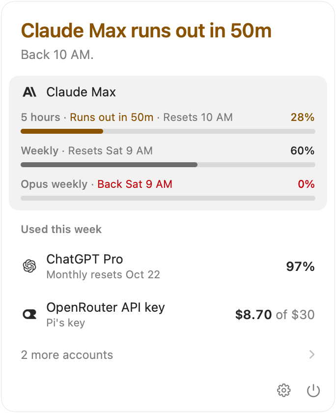
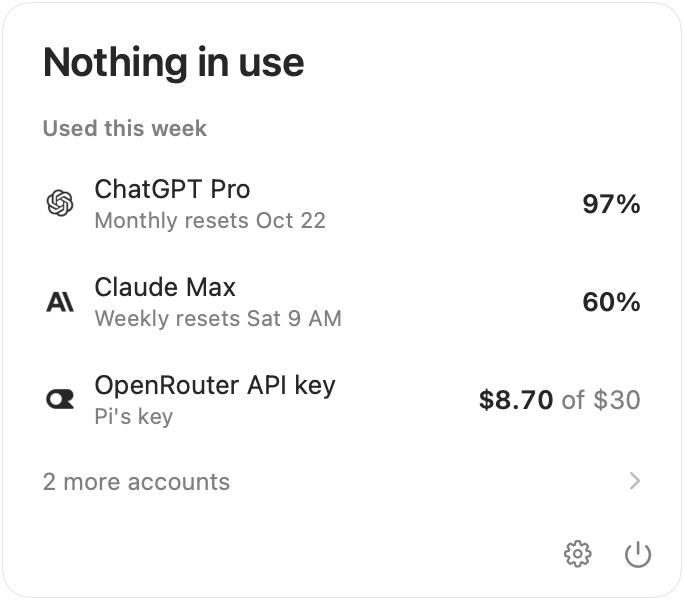
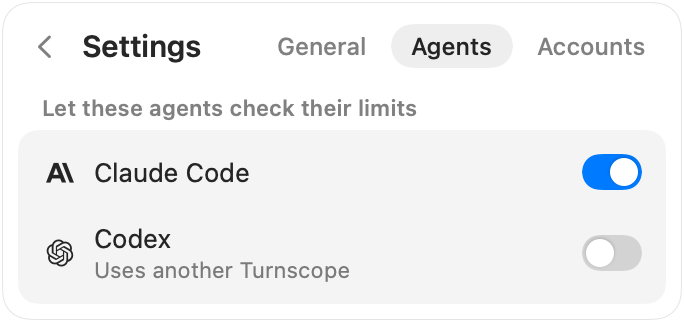

# Turnscope

[](https://github.com/joeychilson/turnscope/releases/latest)
[](https://github.com/joeychilson/turnscope/actions/workflows/ci.yml)
[](LICENSE)

Turnscope shows what's left of your coding agents' usage limits, and
whether it will last until the reset.

<p>
  <picture>
    <source media="(prefers-color-scheme: dark)" srcset=".github/screenshots/panel-dark.png">
    
  </picture>
  <picture>
    <source media="(prefers-color-scheme: dark)" srcset=".github/screenshots/idle-dark.png">
    
  </picture>
</p>

It's a macOS menu bar app, a command line and an MCP server. It reads the
history and logins your agents already keep on your Mac, so there's
nothing to sign in to.

- **Agents:** Claude Code, Codex, OpenCode, Pi, Grok Build, Antigravity
- **Providers:** Anthropic (Claude), OpenAI (ChatGPT), xAI (SuperGrok),
  Google (Google AI), OpenCode Go, OpenRouter

## What it does

- Shows each limit, when it resets, and when it runs out at your pace.
- Notifies you when a limit is about to run out, runs out or is back.
- Shows what used your limits and what it cost, by session, project,
  model, agent or account.
- Writes a handoff, so another agent can finish a session's work.
- Lets your agents check their own limits before a long task.

## Install

Turnscope needs macOS 26, on Apple silicon or Intel.

1. Download `Turnscope-<version>.dmg` from the
   [latest release](https://github.com/joeychilson/turnscope/releases/latest).
2. Open it and drag Turnscope to Applications.
3. Open Turnscope. It lives in the menu bar and checks for updates.

To use the command line, link it onto your `PATH`:

```sh
sudo mkdir -p /usr/local/bin
sudo ln -sf /Applications/Turnscope.app/Contents/Helpers/turnscope /usr/local/bin/turnscope
```

## Command line

```sh
turnscope status                # every limit, when it resets, and the work left
turnscope status --hours 3      # whether 3 more hours of work fit
turnscope usage --by model      # the last 30 days by model, at list prices
turnscope usage --limit week    # what used your weekly limit
turnscope handoff               # a handoff of the latest session in this folder
turnscope doctor                # what can't be read, and how to fix it
```

Add `--json` to any command that prints data. [docs/cli.md](docs/cli.md)
has every command.

## Connect your agents

Turn an agent on in Settings → Agents, or run
`turnscope connect claude-code`. Turnscope adds its MCP server with the
agent's own command.

<picture>
  <source media="(prefers-color-scheme: dark)" srcset=".github/screenshots/agents-dark.png">
  
</picture>

A connected agent can see how much work its limit has left, what used it,
and where another session stopped. See [docs/mcp.md](docs/mcp.md).

For Claude Code, [`guard`](docs/cli.md#guard) stops subagents from
starting when a limit is low, and [`statusline`](docs/cli.md#status-line)
shows your limits under the prompt.

## Privacy

- Turnscope only reads your agents' history and logins. The one change
  it makes is adding or removing its MCP server when you ask, with the
  agent's own command.
- Each login is sent only to its own provider, to read your limits.
  Turnscope stores no secrets.
- It also downloads model prices from [models.dev](https://models.dev) and
  updates from GitHub. There is no telemetry.

## Uninstall

Turn each agent off in Settings → Agents. OpenCode has no command for
this, so [remove it by hand](docs/mcp.md#connect-an-agent). Then quit
Turnscope, move it to the Trash, and remove the command line link, its data
and its settings:

```sh
sudo rm /usr/local/bin/turnscope
rm -rf ~/Library/Application\ Support/com.joeychilson.turnscope
defaults delete com.joeychilson.turnscope
```

## Documentation

- [Command line](docs/cli.md)
- [MCP server](docs/mcp.md)
- [Handoffs](docs/handoff.md)

To work on Turnscope:

- [Development](docs/development.md): build, test and release
- [Architecture](docs/architecture.md): how the binary works
- [The macOS app](docs/app.md) and [its protocol](docs/protocol.md)
- Adding [an agent](docs/adding-an-agent.md) or
  [a provider](docs/adding-a-provider.md)

## Report a problem

Open an [issue](https://github.com/joeychilson/turnscope/issues/new/choose).
Report a security problem privately, as [SECURITY.md](SECURITY.md) says.

## License

[MIT](LICENSE)
